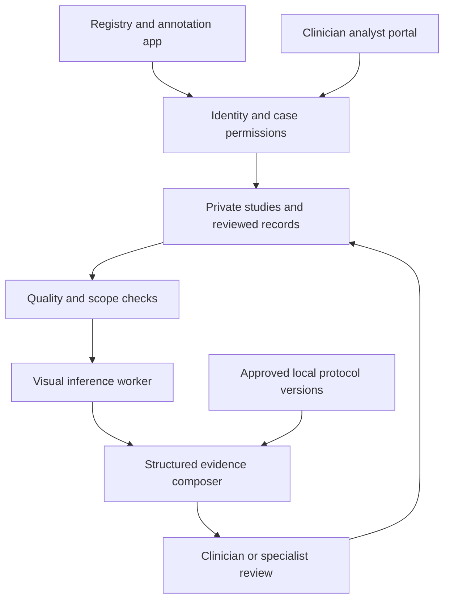

# Orthopaedic X-ray platform: research, methods, SOPs and next stages

Version 1.0 • 8 November 2026 • South African clinical/research context

Use this as the continuing brainstorming and design document. The [Codex conversion guide](CONVERSION_GUIDE.md) defines the immediate build. The [evidence register](EVIDENCE_REGISTER.md) defines primary sources X01–X20, verified facts and limitations. Ideas here are proposals unless explicitly attributed to evidence.

## 1. Vision, scope and first decision

Create two connected applications:

- A registry for appropriately governed radiographs, clinical context, expert annotations and outcomes, with reproducible dataset/model versions.
- An analyst portal that helps a clinician organise a complete study, review provisional image findings and obtain evidence-linked/specialist support.

The database can be anatomically broad from the outset. The first model should answer a narrow question with good reference labels. Proposed starting point: adult acute wrist fracture detection/localisation using the available PA/AP and lateral study views, with the exact expected-view policy approved locally. This scope is a planning default, not a validated clinical indication.

The product should acknowledge that a normal-looking radiograph may not resolve an injury, and that imaging alone does not establish open/closed status, compartment syndrome, perfusion, nerve function or the correct management. The model's visual endpoint and the clinician's care decision must remain distinct.

### Initial hypotheses

1. Structured study capture improves referral completeness.
2. Multi-view input outperforms isolated-image input on the chosen task.
3. A small specialised visual model may outperform a general VLM for fracture localisation.
4. A local dataset may reveal acquisition/case-mix shifts missed by foreign benchmarks.
5. The clinician-plus-AI workflow may matter more than stand-alone accuracy.

Each hypothesis needs a comparator and outcome; none is an established result of this project.

## 2. South African requirements to discover

| Dimension | Questions for the site | Design consequence |
|---|---|---|
| Care pathway | Who requests, acquires, interprets and receives images? When is an orthopaedic/radiology opinion available? | Match the existing team workflow and responsibilities. |
| Imaging access | DICOM export, PACS, web images, printouts, photographed films or screens? | Separate input domains and supported paths; avoid assuming PACS integration. |
| Connectivity | Upload bandwidth, interruptions, shared devices and data costs? | Resumable private uploads, clear state and manual fallback; do not cache patient images casually. |
| Case mix | Adult/paediatric proportions, anatomical sites, delayed presentations, repeat imaging, hardware? | Inventory before selecting the model scope and validation sample. |
| Reference standards | Final radiology reports, independent specialists, follow-up or CT where clinically obtained? | Predefine an attainable, credible adjudication process. |
| Resource constraints | Referral routes, transport, splints, theatre and specialist availability? | Management support must identify local resources without treating constrained care as the biological ideal. |
| Communication | Clinical English, patient language needs and handover conventions? | Structured clinical terms; reviewed language support for any patient-facing text. |
| Ownership | Institution/data custodian, academic sponsor, technical maintenance? | Resolve data access, continuity and IP before collecting or sharing data. |

Do not order repeat radiographs or additional radiation merely because an AI input gate wants another view. An appropriately qualified clinician/radiographer must decide whether additional imaging is justified under local practice.

## 3. Transfer map from burns to orthopaedics

| Burns concept | Orthopaedic equivalent | Additional requirement |
|---|---|---|
| Case/photo gallery | Episode/study/view registry | Study completeness, anatomy and laterality |
| Wound regions | Lesions/fracture regions | Link the same lesion across projections without treating boxes as independent injuries |
| Burn depth | Defined imaging findings/diagnostic target | Separate abnormality, fracture detection, morphology and diagnosis |
| TBSA | No direct equivalent | Remove entirely; any measurements require geometry and calibration rules |
| Serial healing photographs | Serial pre/post-treatment and follow-up studies | Timing and leakage controls |
| Specialist burn review | Orthopaedic/radiology review | Independent expertise, disagreement/adjudication and role policy |
| Management flags | Contextual escalation/referral considerations | Explicit bedside wound/neurovascular information and local protocols |
| AI semantic tags | Reviewed radiological observations and concise rationale | Distinguish human labels, AI drafts and observed treatment |

## 4. Research portfolio and prioritisation

| Track | Concrete question/output | What enables it | Priority |
|---|---|---|---|
| Registry feasibility | Can complete, governed studies be collected and linked to reference assessments? | Clinical sponsor, data inventory and capture workflow | First |
| Structured handover | Does the portal improve completeness and review efficiency? | Usability study and workflow comparator | First useful workflow study |
| Capture/view quality | Can unusable/missing/incorrectly grouped views be flagged? | Quality labels and declared input domains | Early AI experiment |
| Annotation tooling | Do boxes/assisted regions reduce review burden? | Independent labels and timing study | Early |
| Fracture detection/localisation | Can a narrow target be identified reproducibly? | Study-level positives/negatives and localisation labels | Main retrospective model study |
| Multi-view fusion | Does combined input improve the same endpoint? | Patient-linked view sets | After baseline |
| Similar-case retrieval | Are returned reviewed studies relevant and useful? | Permissioned labels, embeddings and relevance assessment | Optional research/education |
| Report assistance | Can structured observations become supported draft reports? | Validated observations and reviewed outputs | Later adjunct |
| Paediatric lane | Can age-specific injuries be supported safely? | Dedicated labels and validation; no adult-model extrapolation | Separate programme |
| Pre/post-reduction support | Can change be measured consistently? | Linked views, defined geometry and specialist reference | Later |
| Union/hardware follow-up | Can trajectory and complications be studied? | Longitudinal labels and follow-up; separate ontology | Later |
| Infection/tumour/pathological fracture | Can complex pathology be recognised? | Specialist data, non-radiograph context and different reference standards | Separate intended use |

Avoid scope drift: do not add CT, spine trauma, tumour diagnosis, operative planning and paediatric classification to the first model because the UI can display those cases. A comprehensive platform is compatible with a narrow model.

## 5. Public datasets and local data strategy

MURA supplies a study-level abnormality benchmark, while FracAtlas supports fracture-region tasks and GRAZPEDWRI-DX is specifically paediatric wrist data. They answer different questions and cannot be pooled under a single binary label without a defensible mapping. See X01–X03 for sizes, sources and terms.

Proposed use:

1. Investigate public datasets for pipeline development and task-specific external comparisons after terms review.
2. Audit the local institution's data, including independence, provenance, images per study, labels and follow-up.
3. Build a local annotation pilot with independent assessment and adjudication.
4. Fix a private target-setting test cohort before adaptation. Public-model pretraining contamination is a reason to retain a nonpublic local evaluation set where permitted.
5. Treat any licensed external data, local training data, calibration data and held-out data as separately tracked datasets.

Do not assert that a public dataset includes patient identifiers suitable for grouping if the files do not provide them. Unknown grouping is a limitation; image-random splits cannot establish patient-independent generalisation. Respect original public test splits and create an additional leakage-aware protocol only where the metadata permits it.

### Data inventory template

| Field | Required audit answer |
|---|---|
| Patients / episodes / studies / images | Separate counts and how deduplication/linkage was performed |
| Source | Institution, modality, machine, acquisition period and export path |
| Eligibility | Care/research/training/publication permission and restrictions |
| Target | Exact finding, anatomy, age and decision time |
| References | Report/expert review/follow-up evidence, with availability and timing |
| Input quality | Views, bit depth, identifiers, compression, combined images and capture domain |
| Missingness | Age, laterality, examinations, review, negative labels and follow-up |
| Distribution | Site/age/anatomy, fracture prevalence, casts/hardware and uncommon cases |

## 6. SOP suite

These are operational templates requiring clinical, technical and governance review. Assign an owner, version, effective date and review date before use.

### SOP 01 — Governance and onboarding

Define intended use, participating sites, lawful basis, data custodian, operators, training rights, retention and publication scope. Assess ethics/institutional/provincial requirements and the SAHPRA implications of the intended use. Provision named roles and minimum necessary access. Document incident and withdrawal contacts. Do not equate a consent checkbox, an ethics application or a provider's security page with completed compliance. References X15–X18.

### SOP 02 — Study acquisition and grouping

Verify patient/episode linkage through the approved institutional process before pseudonymisation. Record indication, injury time, acquisition time, body site, side, view source and trauma phase. Preserve linked views and identify combined-image exports. Record missingness explicitly. Prevent accidental mixing of patients or pre/post-reduction studies. Validate transfer integrity and avoid duplicate uploads. Clinical staff determine whether views are adequate for the question.

### SOP 03 — De-identification and quarantine

Create a research copy with reproducible policy. Process identifying tags, safe private-tag policy, UIDs/linkage and dates consistently; preserve clinically required relative timing. Inspect overlays and burned-in pixels, including photographed monitor backgrounds. Irreversibly remove identifiers from released research pixels where required; a removable overlay is insufficient (X06). Preserve useful anatomy/markers, document any crop and maintain restricted lineage. Use human review for ambiguous text. Mark readiness only after the required review; exclude quarantined images from training and retrieval.

### SOP 04 — Technical quality and interpretation scope

Decode using supported transfer syntax/photometric rules. Check dimensions, bit depth, inversion, clipping, exposure/contrast suitability, motion, anatomy coverage and expected views. Record capture domain. Unknown/conflicting laterality stays unresolved until reviewed. Flag unsupported ages/anatomy/hardware domains against model scope. A study can be stored while analysis is refused. Do not collapse inadequacy to a negative diagnosis.

### SOP 05 — Annotation and reference standard

Use a written ontology with examples and unknown states. Label study-level fracture status separately from image/lesion localisation. Record bones/segments, morphology/alignment and classifications only when justified. Choose the reference assessment process prospectively: independent appropriately qualified readers, adjudication and any confirmatory/follow-up evidence used. Keep the reference reviewers blinded to model suggestions where feasible. Capture disagreement rather than hiding it. Specify whether a label means “radiographically visible now” or “final confirmed fracture”; these targets can differ for occult injuries.

### SOP 06 — Review, corrections and eligibility

Workflow: uploaded → quarantined/quality-reviewed → annotation draft → independent review → disagreement/adjudication → accepted. Track rejected/withdrawn states separately. An analysis draft does not become an expert label through saving. Preserve prior annotation versions and reasons for edits. Training eligibility requires both accepted target labels and permitted use. Public educational publication is a separate decision.

### SOP 07 — Dataset freeze, splits and exports

Freeze a versioned cohort and ontology. Group by patient across all episodes/views/derived images/serial studies where linkable. Run exact/perceptual duplicate detection plus manual review of suspicious pairs. Separate development, calibration and final test; designate external/temporal cohorts. Avoid exporting labels or metadata that leak future outcomes into inputs. Store immutable manifests, exclusion reasons, hashes and seed/configuration. Filter retrieval examples to the allowed development pool during evaluation. Apply withdrawal decisions to future exports and define model-remediation policy explicitly.

### SOP 08 — Training and experiment recording

Validate the manifest and label mapping before training. Record exact model/data/preprocessing/code versions, seeds, hardware, hyperparameters, stopping rule and measured costs. Compare with a simple baseline. Fit calibration only on its reserved data. Use conservative image transformations that preserve anatomy/markers; no untracked flips or unrealistic rotations/contrast changes. Log failures and subgroup findings. Synthetic data tests validate mechanics, not clinical performance. Never describe an interrupted run or downloaded base model as a trained local model.

### SOP 09 — Analysis and specialist review

Check identity, access, study version, model scope and input readiness. Preserve clinical concern independently of AI. Return provisional image findings and limitations, with the exact views used; escalate unsupported/indeterminate cases to the manual workflow. Cite the approved local evidence used for any management consideration. A clinician reviews the draft and records a disposition; specialist advice is separately attributable. Retain an audit trail without exposing image links in routine logs.

### SOP 10 — Promotion, monitoring and incidents

Require a fixed version, evaluation report, scope, reviewer and operational owner before promotion. Start with silent prospective observation if approved, then a controlled supervised feasibility study. Monitor input drift, unsupported domains, accepted-versus-abstained performance, important misses, user corrections, delayed jobs and access incidents. Define stopping rules and rollback. A model update—including quantisation or preprocessing—may require renewed calibration/validation. Disable affected analysis on incident while retaining the approved manual pathway.

## 7. Data contracts and semantic reasoning

Maintain structured observations, diagnostic assessment, management considerations and outcomes separately. Link every finding to its source image(s), region geometry, assessor, evidence and time. Store concise evidence-linked rationale, not asserted access to an AI's hidden reasoning. Clinical management must not be trained from historical actions without reviewing appropriateness and resource constraints.

Illustrative synthetic output shape:

```json
{
  "schema_version": "0.1",
  "study_id": "synthetic-study-01",
  "study_version": 1,
  "mode": "demo",
  "model": {"id": "deterministic-mock", "artifact_hash": null},
  "scope": {"supported": false, "reason": "demonstration_only"},
  "input_summary": {"views": ["PA"], "laterality": "unknown"},
  "quality": {"status": "incomplete", "limitations": ["missing_expected_view"]},
  "findings": [],
  "assessment": {"status": "not_assessed", "probability": null},
  "clinical_context": {"neurovascular_status": "not_provided"},
  "considerations": [],
  "guideline_refs": [],
  "review": {"state": "draft", "training_eligible": false}
}
```

For real models include model revision, preprocessing/calibration versions, training/model-card reference and input hashes. A study-level probability must declare its target. No finding is not the same as an explicit reviewed negative. Numeric confidence is unavailable unless meaningful for that validated task.

## 8. Visual model architecture options

### A. Small supervised baseline

Use a pretrained image encoder (for example, a standard DINOv2 backbone or a medical encoder such as MedSigLIP) with a linear/logistic head. Freeze features first, then compare selective fine-tuning. This establishes whether a larger generative model is needed. Evaluate each view and the complete study separately, without averaging away missing-view flags.

### B. Fracture detector

Use a licensed detector with expert region labels to propose boxes. Choose architecture/implementation/weights after license review; do not assume all YOLO-family implementations have identical terms. Evaluate localisation with clinically appropriate false-positive burden and lesion recall. Fracture-line annotations, broad lesion boxes and bone masks are different targets. A segmentation mask is not automatically a clinically meaningful fracture description.

### C. Multi-view study model

Encode each view, retain view and laterality provenance, then compare simple pooling with learned attention/set aggregation. Handle missing/duplicate/unknown views explicitly. Link per-view findings to study-level lesions; two boxes on two views may describe one fracture. The model does not automatically reconstruct a calibrated 3-D injury from two projections.

### D. Multimodal report model

Compare MedGemma 1.5 4B and Qwen3-VL-8B-Instruct for constrained structured findings/reports. Use identical case inputs, output contracts and assessment rubric. Medical pretraining is a hypothesis for transfer, not proof of musculoskeletal skill (X07–X09). Use local full-resolution/multiscale processing or validated crops where needed; small fracture features may be lost when downsampled for a VLM. Always preserve anatomical context and record crop coordinates.

Only consider LoRA/QLoRA after a frozen baseline. Use reviewed image/context → structured target/rationale pairs. Do not train a report model to invent boxes, examination findings or recommendations unsupported by its inputs. Reject schema-invalid output and report unsupported fields explicitly.

### E. Retrieval and evidence layer

Use embeddings to find authorised, reviewed analogous studies, filtered by anatomy/age/input domain and model evaluation restrictions. Keep clinical guideline retrieval separately versioned from the case atlas. Similar appearance is neither a reference diagnosis nor proof of appropriate treatment. Evaluate anchoring and misleading matches, not only retrieval speed.

### F. Hosted comparator

An institution-approved external visual model may provide a stronger baseline or lower operational cost at low volume. Verify current model/version, data-use terms, retention, geographic processing and cost before any clinical transmission. No provider is selected or authorised here. Compare it fairly against local models with the same held-out cases.

### Proposed service topology



Inference jobs are explicitly invoked operations. Reviewed records become future training candidates only through eligibility checks and a dataset freeze, not through an automatic feedback loop.

## 9. Reproducible training programme

| Step | Deliverable | Decision it resolves |
|---|---|---|
| 1. Label feasibility | Pilot agreement, adjudication rate and annotation time | Is the target label usable? |
| 2. Cohort audit | Independent patient counts, missingness and prevalence | Is this population represented? |
| 3. Frozen splits | Patient-aware manifests and external/temporal plan | Can evaluation avoid leakage? |
| 4. Baselines | Clinical-only, image encoder and unmodified VLM results | What value does each input/model add? |
| 5. Localisation/multi-view | Matched comparisons on the same endpoint | Is complexity justified? |
| 6. Adaptation | Controlled head/backbone/adapter experiments | Does training improve generalisation? |
| 7. Calibration | Reserved-data thresholds, reliability and abstention | Can scores support a defined decision? |
| 8. Independent test | Locked cohort report and important-error review | Does the selected version meet agreed criteria? |
| 9. Prospective study | Silent then supervised workflow protocol if approved | Is it usable and safe in the target setting? |

Use learning curves over independent patients/studies to decide whether additional annotation or model complexity is the better investment. Do not promise that a fixed number of images is sufficient. Active learning can prioritise diversity/uncertainty but should not repeatedly sample only one pathology or expose the reference test set to development.

### Important leakage and shortcut risks

- Same patient, repeated acquisition, cropped copy or adjacent follow-up in different splits.
- Post-reduction fixation/cast or later reports leaking the initial diagnostic target.
- Hospital logos, acquisition markers, machine or referral patterns correlating with labels.
- “Fracture” derived mechanically from report text that contains uncertainty or historical findings.
- Reference labels generated or strongly influenced by the same model being evaluated.
- Retrieving the test patient's final report or near-duplicate as a similar example.
- Downstream clinical variables unavailable when the prediction would actually occur.

## 10. Evaluation and evidence gates

Use the target clinical decision as the unit of evaluation. Study-level sensitivity/specificity, patient-clustered uncertainty and clinician impact matter alongside lesion-level detection. AUROC alone does not describe under-triage, calibration or the number of false alerts a doctor sees.

| Evaluation | What to report |
|---|---|
| Detection/classification | Sensitivity/specificity, AUROC/AUPRC, prevalence, PPV/NPV and thresholds |
| Localisation | Lesion recall/FROC or suitable detection metrics, false positives per study and clinically important misses |
| Calibration | Reliability, Brier score, confidence intervals and risk-coverage for abstention |
| Subgroups/domains | Site, anatomy, age, sex if appropriately available, machine, views, cast/hardware and acquisition domain |
| Report quality | Unsupported claims, wrong anatomy/laterality, invented findings, source support and missing-data handling |
| Workflow | Review time, completeness, correction rate, under/over-referral, automation bias and usability |
| Systems | Queue delay, failed uploads, lost/duplicate studies, access denial correctness and incident handling |

Skin-tone fairness methods from burn photography do not directly transfer to radiographs. For this project prioritise relevant acquisition, demographic and clinical strata; collect sensitive variables only when justified and governed. Do not infer ethnicity or sensitive diagnoses from images for profiling.

Define sample size with a statistician around the target sensitivity/uncertainty, prevalence and site clustering, rather than a convenient image total. Set go/no-go and stopping criteria prospectively with clinical owners. External validation, prospective clinical evaluation and regulatory/institutional assessment are different gates. Reader-study precedents X04/X05 show a study design, not expected results for this product.

## 11. Database, authentication and analyst connection

### Proposed infrastructure

- Supabase Auth for identity; institution memberships and case access for authorisation.
- Postgres for pseudonymous episodes/studies/annotations/labels and job/model metadata.
- Private object storage for originals and controlled derivatives; no base64 image-table design.
- pgvector for permission-filtered reviewed-case retrieval if it proves useful.
- A separate inference service/worker for image processing and GPU models.
- A backend API that validates scope and permissions, composes structured outputs and records provenance.

Supabase supports private buckets and row-level permission-aware retrieval; actual policies must be implemented and tested (X14). Merely hiding a gallery behind login does not protect objects. Model workers often have elevated access, so their input/retrieval queries need explicit policy and validation rather than assuming all operations inherit frontend RLS.

### Connection sequence

1. Implement both apps against synthetic adapters and shared contracts.
2. Implement local Supabase migrations, test identities and institution/case policies.
3. Verify login/logout, session validation, role restrictions, private upload/download and cross-case denial through direct API calls.
4. Add asynchronous analysis jobs tied to study/version and capability declarations.
5. Connect a deliberately configured research artifact; verify exact preprocessing and output contract.
6. Verify end-to-end submit → authorised storage → worker → structured result → clinician review.
7. Prepare approved hosting/operations separately from GitHub source publication.

If only demo mode has been run, say so. No missing backend or model should silently trigger a realistic-looking mock diagnosis. Design failure states that preserve the manual clinical workflow.

## 12. Resource and cost model

These are illustrative calculations, not provider quotes or measured project costs.

- **Raw pixels:** a 3,000 × 3,000 × 16-bit uncompressed image contains about 18 MB of pixel data. Two views per study across 10,000 studies would be roughly 360 GB before compression, metadata, derivatives or backups. Actual export sizes must be measured; shrinking to a JPEG is not an equivalent clinical representation.
- **Annotation:** 500 studies × 6 minutes × 2 reviewers = 100 reviewer-hours before adjudication. Measure local time and remuneration separately.
- **Serving:** monthly cost = fixed services + study volume × measured inference cost + object storage/backup/egress + operational review/support. Include failed/retried jobs and cold starts.
- **Training:** begin with frozen features and small heads. Record actual GPU memory/time at the chosen resolution and view count; model size alone does not determine feasibility. Avoid procuring large compute before dataset feasibility.
- **Workforce:** clinical sponsor, radiology/orthopaedic reference assessors, data steward, ML engineer/researcher, application engineer and statistical/governance input. Codex can scaffold and implement engineering, not supply expert reference standards or regulatory decisions.

## 13. Indicative roadmap and dependencies

| Stage | Concrete output | Key gate |
|---|---|---|
| Local conversion | Two functioning synthetic apps, contracts and tests | Both repos ready before destination URLs |
| Institutional feasibility | Intended use, workflow map, data inventory, sponsor and protocol | Data rights and usable reference standard |
| Annotation pilot | Reviewed/adjudicated cohort and measured effort | Label agreement and completeness |
| Retrospective research | Frozen baselines, selected adaptations and held-out report | Generalisation and safety analysis |
| Prospective evaluation | Approved silent/reader/workflow study | Clinical benefit and operational feasibility |
| Deployment planning | Regulatory assessment, ownership, monitoring and maintenance | Evidence for the exact intended use |

Timelines depend on approvals, labels and personnel. A locally working application is achievable independently of clinical data; a validated diagnostic model is not an engineering-only milestone.

## 14. Pitching the orthopaedic project

### Core pitch

> We are developing a clinician-reviewed musculoskeletal radiograph registry and assessment workspace for South African care settings. The first phase will test structured study capture, reference annotation and a narrow fracture-assessment research task. The portal will keep clinical examination, uncertainty and specialist review visible while we evaluate whether visual AI adds useful support.

### Match the ask to the audience

| Audience | Lead with | Concrete ask |
|---|---|---|
| Orthopaedics/radiology | Workflow gap, intended use, review burden and diagnostic safety | Named owner, annotation design discussion and feasibility pilot |
| Hospital management | Data stewardship, staff time, local infrastructure and measurable workflow outcomes | Sponsor and appropriate ICT/governance introductions |
| Academic supervisor | Research question, reference standard, independent sample and feasible student contribution | Supervision, study design and statistical support |
| Grant panel | Milestones that reduce uncertainty, local relevance and realistic budget | Bounded feasibility/annotation/baseline funding |
| Technical partner | Integration contracts, viewer, data security and reproducibility | Specific scoped engineering/ML deliverable |
| Commercial partner | Adoption, support, procurement and validated scope | Discovery/integration discussion; no invented revenue projections |

Suggested demonstration: log into a synthetic case, show PA/lateral grouping, mark an unknown clinical finding, run a labelled mock analysis, reveal uncertainty, correct a region and submit independent review. Then show the evidence/model status and explain the next validation gate. Demonstrate an unsupported paediatric or poor-quality study as well as an easy-looking example.

Six-slide sequence: local problem → two workspaces → synthetic case with human review → evidence and study design → milestones/resources → one bounded ask. No fictional hospital endorsement, invented local burden statistics or accuracy borrowed from a public paper. Permission to access data is not permission to redistribute it or publish derived weights.

### Claim readiness checklist

Before saying “trained,” identify the actual checkpoint, dataset and completed run. Before saying “validated,” identify the exact cohort, reference, endpoint and uncertainty. Before saying “South African,” distinguish locally motivated design from evaluation on local data. Before saying “improves care,” identify appropriate clinician/workflow or patient evidence. Before saying “approved/compliant,” identify the actual scope-specific basis.

## 15. Continuing brainstorming board

Maintain a dated table in the repo:

| Proposal | Problem/beneficiary | Evidence gap | Smallest experiment | Owner | Cost/dependency | Decision date |
|---|---|---|---|---|---|---|
| Multi-view wrist pilot | Target frontline clinicians | Label quality and local baseline unknown | Reviewed annotation pilot and matched baseline | To assign | Approved studies + assessors | To set |
| Referral completeness | Specialist receiving incomplete cases | Actual local missingness unknown | Workflow audit and synthetic usability sessions | To assign | Clinical sponsor | To set |

Update this board, decision log, claims ledger and source register after each research/pitch discussion. Prioritise one clinical question and one engineering milestone at a time. Future features should earn a place through a measured problem and feasible experiment rather than expanding the first scope indefinitely.
